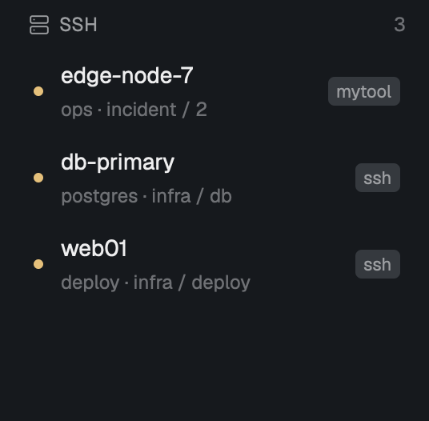

# SSH sidebar

A sidebar block that lists every SSH session open in a Herdr terminal, whatever space or machine it is in. Each row names the remote host, the login user and where the terminal lives; a click goes to that terminal, and a right-click copies its address or a note that tells a coding agent how to read it. Rows appear when `ssh` becomes a terminal's foreground program and vanish when it exits.



## What you see

One block, meant for a sidebar column about 208 to 268 px wide. It fills the size the layout gives it. Top to bottom:

- **The block.** Background `chrome`, a 1 px `border`-colored line along its top edge, text 14 px.
- **Heading**, 31 px tall, padded 18 px left and 14 px right. On the left a 13 px server glyph (`server.svg`, tinted `muted`) then 6 px gap and the word `SSH`, 12 px, medium weight, `muted`. On the right the number of sessions, 12 px, `dim`; no number when there are none.
- **Empty state**, only with no sessions: `No SSH sessions. A terminal running ssh shows up here.`, centered, 12 px on a 16 px line, `dim`, padded 16 px.
- **The list**, taking the rest of the height and scrolling vertically. Padded 8 px left and right and 8 px at the bottom, rows 2 px apart.
- **A row**, padded 10 px sideways and 5 px above and below, corners 6 px, its parts 8 px apart and centered vertically:
  - a 6 px round dot with 3 px of margin each side, colored `working` (falling back to `accent`);
  - two lines that take the remaining width and truncate: the host, `foreground`; under it, 12 px and `dim`, the login user, the machine's name (only for a terminal on another machine) and the terminal's space and tab, joined by ` · `. The second line is left out when it would be empty;
  - a tag naming the command that opened the session (`ssh`, or the person's wrapper), 11 px, `muted` on `raised`, padded 5 px sideways, corners 4 px.
- **With the tag set below**, the row has no tag at its end, so the host takes the whole width; the second line starts with the tag, then 6 px gap and the user, machine and place, which truncate. The second line is then always there, holding at least the tag.
- **The row with the keyboard** (its terminal is the focused one) has a `selected` background. Other rows get `hover` under the pointer.
- **The right-click menu**, a popup 248 × 76 px at the pointer: background `popover`, padded 4 px, text 14 px, two items 28 px tall, padded 8 px sideways, corners 4 px, `foreground`, `selected` under the pointer: `Copy terminal address` and `Copy note for an agent`.

Every color is a theme color by name, so it follows the layout's theme, light or dark.

## How it behaves

- **What counts as a session.** A live terminal whose foreground process is `ssh` or `autossh`, or one of the names in the person's `ssh-terminals.json`. A name matches the foreground process's name, the first word of its command line, or, when the process is an interpreter (python, node, ruby, perl, php, lua, deno, bun, a shell, PowerShell), the script it runs. Names are compared by their last path part, lower-cased, without `.exe`.
- **The host shown.** If the terminal's title starts with `user@host` and that host is not the terminal's own machine, the title's host and user are used: the remote shell has set it, and it is the machine actually reached. Otherwise, for `ssh`/`autossh`, the destination parsed from the command line (`user@host`, `ssh://user@host:port`, `-l user`, `-p port`, options that take a value skipped); for a wrapper, its arguments joined by spaces.
- **Order.** Most recently used first: a session is stamped when its terminal takes the keyboard, and one never focused is placed by when its terminal was created. Stamps survive restarts and are dropped when the session ends.
- **Click** a row: goes to that terminal's pane, switching space and tab. If another pane in that tab is zoomed, it is unzoomed first. A terminal with no pane (started with `hc run`) opens as a peek instead.
- **Right-click** a row: opens the menu. Either item copies to the clipboard, closes the menu and shows a `Copied` toast for 2.5 s with the copied text. The address is the terminal's (`t7`, or `machine/t7`). The note reads: ``My SSH session on <host> is Herdr terminal <address>. Read its output with `hc read <address> --lines 200`. Read only: do not type into it.``
- **Agent statuses** (working, blocked, done, idle) are not shown: this lists SSH sessions, not agents, and every row has the same dot.
- **What moves.** Nothing is animated. The list redraws when Herdr's terminals, focus or theme change; there is no polling for those.
- **The person's own commands.** `<Herdr home>/ssh-terminals.json`, `{ "commands": ["mytool"] }`, is read at start and every 10 s. A missing or invalid file means `ssh` and `autossh` only.
- **Where the tag goes.** The same file's `"tag"`: `"beside"` (the default, and what any other value means) puts it at the end of the row, `"below"` at the start of the second line, for long host names in a narrow sidebar. A change shows within 10 s.

## Built from

- **Files:** `mods/ssh-sidebar/main.js` (the view), `match.js` (the rules, pure functions, no host calls), `server.svg` (the heading's glyph), `mod.json` `{ "place": "none", "title": "SSH" }`. No keys, no layout: the person puts the block where they want it, e.g. above the agents list of a layout they own:

  ```json
  { "id": "ssh", "type": "block", "content": { "mod": "ssh-sidebar" }, "size": { "weight": 0.5 }, "min": 70 }
  ```

- **`props` roles:** none in a layout. The menu is the same mod opened as an overlay with `{ menu: true, session: { address, host } }`; `render` and `init` branch on `props().menu`.
- **`herdr` functions:** `terminals()` (each one's `state`, `address`, `title`, `created_ms`, `labels.where` and `foreground: { name, argv }`), `panes()`, `focused()`, `theme()`, `props()`, `appHome()`, `readTextFile`, `exec`, `hc`, `openOverlay({ kind: "popup", at: "pointer", width: 248, height: 76 })`, `closeOverlay`, `notify`, `run`. The clipboard is `cx.write_to_clipboard`. `localStorage` key `used` holds the focus stamps.
- **Commands:** `pane.focus {pane}`, `pane.zoom {pane}`, `terminal.peek {terminal}`.
- **Programs it runs:** `hostname` on this computer and `hc machine ls --json`, at start and every 120 s, to learn each machine's own hostname (`machines[].host`). No network access. It reads one file outside its folder, `<Herdr home>/ssh-terminals.json`, and writes none.
- **`match.js`:** `sshSessions(list, extra, hostnames)` returns `{ address, machine, tool, host, user, target, port, command, title, where, created_ms }` per session; `commandsOf(text)` and `tagOf(text)` read the config; `parseSsh`, `parseTitle`, `baseName`, `machineOf` are its parts.
- **Shipped mods used:** none. The heading and rows follow the shipped agents list's measures so the block sits beside it without a seam.

## Watch out

- The foreground process of a wrapper written in Python is `Python`, not the wrapper: match the script name in `argv[1]`, and only when the process is an interpreter, or `vim ssh` counts as a session.
- A terminal's title still shows the local prompt (`me@mybox:~`) until the far side sets one. Compare the title's host with the terminal's own machine's hostname, by the part before the first dot and ignoring case (`mybox` and `mybox.local` are the same), before trusting it.
- `terminals()` carries the full record including `foreground`; `hc ls --json` from a shell does not, there it takes `hc get <address> --json` per terminal.
- An address on another machine is `machine/t7`. Hostnames are keyed by that prefix, `""` for this computer.
- Stamp focus only when the focused terminal changes, not on every render, and write `localStorage` only then.
- `mod.json` says `"place": "none"`: Herdr docks nothing by itself, and its own layouts (`main`, `terminals`, `win98`) are replaced on every start, so the block can only go in a layout the person owns (`layout.clone` first).
- The menu opens the mod by its folder name, the `MOD` constant: a copy under another name must change it.
- Not seen: SSH started inside tmux or screen (the foreground process is the multiplexer), and `mosh`.
- The tag takes room from the host on a narrow sidebar: at 208 px a long host name truncates. That is what `"tag": "below"` is for; do not drop the tag instead.

## Done when

- `herdr-app check mods/ssh-sidebar` passes.
- With the block in a layout and no SSH session open, it shows the heading `SSH` with no count and the empty-state sentence.
- Running `ssh somehost` in any pane of any space adds a row within a moment, tagged `ssh`, and the count becomes 1; ending the session removes it.
- Once the remote shell sets the title to `user@host: ~`, the row shows that host and user.
- Adding a wrapper's name to `ssh-terminals.json` makes its sessions appear within 10 s, tagged with that name.
- Setting `"tag": "below"` in `ssh-terminals.json` moves every row's tag to the start of its second line within 10 s, and a host name that was cut short gains the freed width; removing it puts the tag back.
- Clicking a row for a terminal in another space shows that space and tab with the terminal focused, and the row takes the `selected` background.
- Right-clicking a row and choosing `Copy terminal address` puts the address on the clipboard and shows the `Copied` toast.
- `vim ssh` in a pane adds no row.
